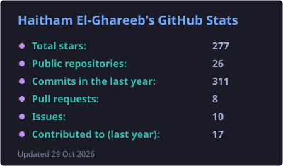
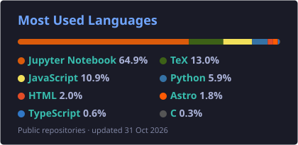

<h1 align="center">👋 Haitham El-Ghareeb · هيثم الغريب</h1>

<b>Assoc. Professor, Faculty of Computers &amp; Information Sciences · Mansoura University · Egypt</b> 
<i>Editor-in-Chief, Mansoura Journal of Computer &amp; Information Sciences (MJCIS)</i>

  
  
  

  
  
  
  
  
  

---

### 🧭 About
I build and teach **trustworthy systems — in code, in research, and in knowledge.** One principle
runs through all of it: **أمانة — honesty**. Four things I care about:

- 🔬 **Research** — uncertainty-aware, *honest* AI: neutrosophic/plithogenic methods, calibration,
  selective prediction, conformal coverage, leakage-safe evaluation (medical AI, IoT/edge, IDS, distributed data systems).
- 🎓 **Academia** — Assoc. Professor at Mansoura University &amp; Editor-in-Chief of **MJCIS**; 70+ thesis committees; mentoring grad students.
- 💻 **Software &amp; systems** — I build in the open. Reviewer for international journals; OSS contributor.
- 🕌 **Islamic knowledge** — I author and edit works on hadith and uṣūl al-fiqh, making classical scholarship open and accessible.

### ⭐ Featured — my first open-source product
> ### 🎧 [Sada · صدى](https://github.com/helghareeb/echo)
> A **free, open-source, cross-platform** app that turns audio into subtitles (`.srt`/`.txt`),
> **tuned for Arabic** — a community restoration of the discontinued *almufragh*.
> Runs on **Windows, macOS, Linux, and the browser**. Built with **React · Vite · Electron ·
> ffmpeg.wasm · Wit.ai**. `MIT`.
>
> ⭐ **[github.com/helghareeb/echo](https://github.com/helghareeb/echo)** — stars &amp; PRs very welcome!

### 🎓 Teaching — Data Structures &amp; Algorithms (DSA27)
> An open course in Python, Fall 2026, built in the open on GitHub:
> **[github.com/helghareeb/DSA27](https://github.com/helghareeb/DSA27)**
>
> - 📖 **15 lectures** (handouts + slides), **15 lab manuals**, a students' book, and worked solutions
> - 🧪 **Interactive labs** that run the code step by step:
>   [Array](https://helghareeb.github.io/DSA27/lectures/02-complexity-and-arrays/array-lab.html) ·
>   [Recursion](https://helghareeb.github.io/DSA27/lectures/03-recursion/recursion-lab.html) ·
>   [Linked List](https://helghareeb.github.io/DSA27/lectures/05-linked-lists/linked-list-lab.html) ·
>   [Stack](https://helghareeb.github.io/DSA27/lectures/06-stacks/stack-lab.html) ·
>   [Queue](https://helghareeb.github.io/DSA27/lectures/07-queues/queue-lab.html)
> - ✅ A **question bank** with answers, mock exams, and
>   [online quizzes](https://helghareeb.github.io/en/quizzes/) in English and Arabic
> - ⏱️ A **[midterm exam simulator](https://helghareeb.github.io/en/quizzes/dsa27/midterm/)** — a fresh timed paper every time

### 🔬 Currently building
- 🧠 A program of **uncertainty-aware ML audits** (Scientific Reports / IEEE Access) — honest evaluation, calibration, and trustworthy intrusion detection.
- 📚 **Athar (أثر)** — an open, narrator-resolved hadith corpus with uncertainty-aware transmission embeddings.
- 🎬 A YouTube channel (**@helghareeb**) across research, software, academia, and Islamic knowledge.

### 🧰 Tech

---

  
  

<i>Make the strongest claim the work can honestly support.</i>

